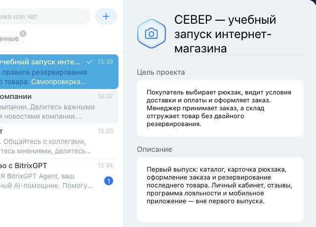
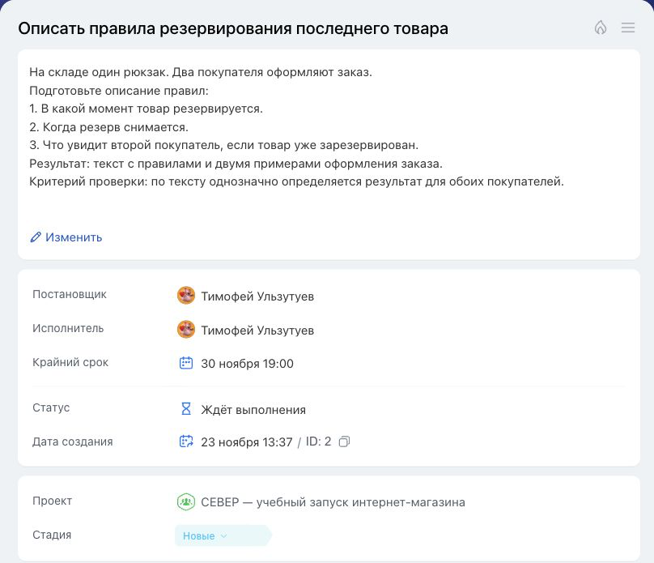
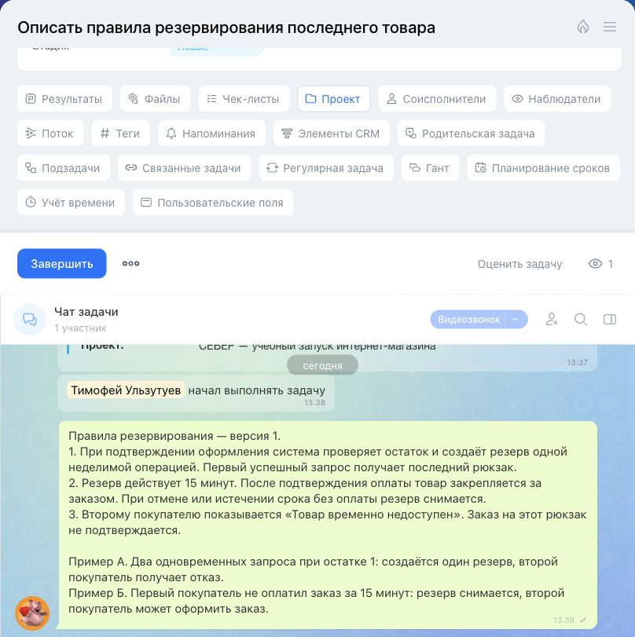
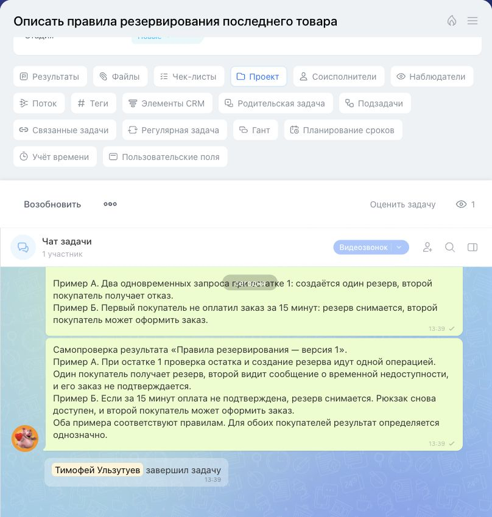
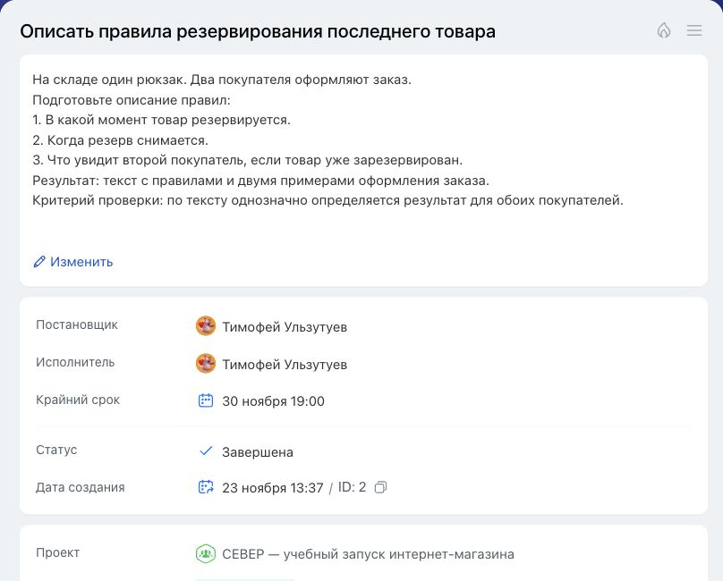
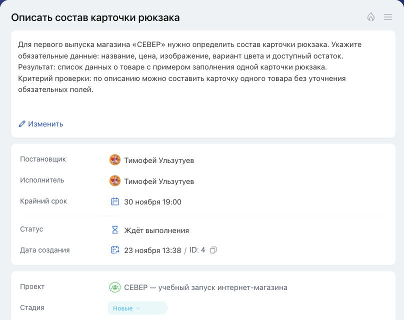
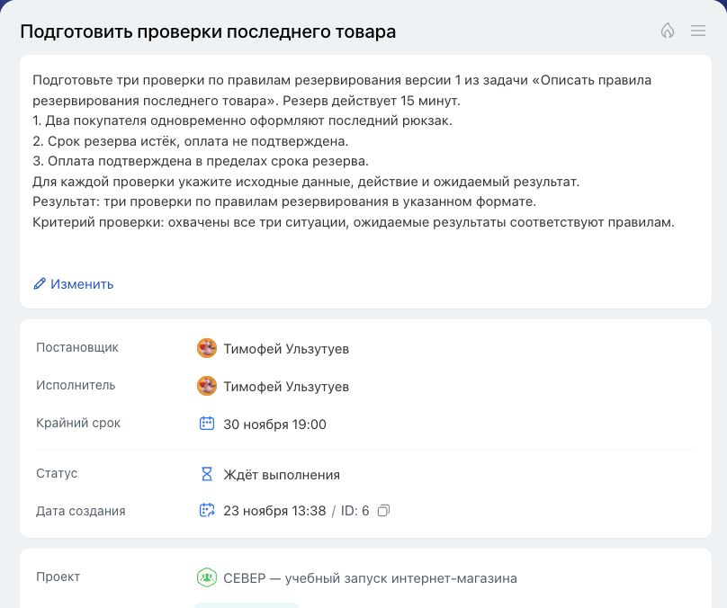

# Отчёт по теме 2. Проект, задача и результат

Репозиторий: https://github.com/TimUlz/project-management

Проект: https://b24-b1gqny.bitrix24.ru/workgroups/group/2/

Задача 1: https://b24-b1gqny.bitrix24.ru/workgroups/group/2/tasks/task/view/2/

Задача 2: https://b24-b1gqny.bitrix24.ru/workgroups/group/2/tasks/task/view/4/

Задача 3: https://b24-b1gqny.bitrix24.ru/workgroups/group/2/tasks/task/view/6/

## Скриншоты

- [Проект: название, цель и границы](screenshots/01-project.png)

  

- [Условия первой задачи](screenshots/02-task-reservation.png)

  

- [Результат: правила и два примера](screenshots/03-result.png)

  

- [Самопроверка или отзыв](screenshots/04-review.png)

  

- [Завершённая первая задача](screenshots/05-completed.png)

  

- [Условия задачи о карточке товара](screenshots/06-task-product-card.png)

  

- [Условия задачи о проверках](screenshots/07-task-checks.png)

  
