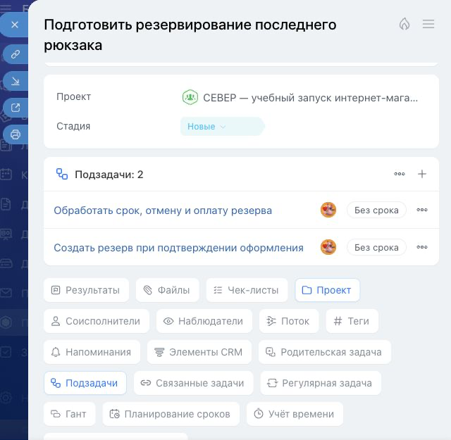
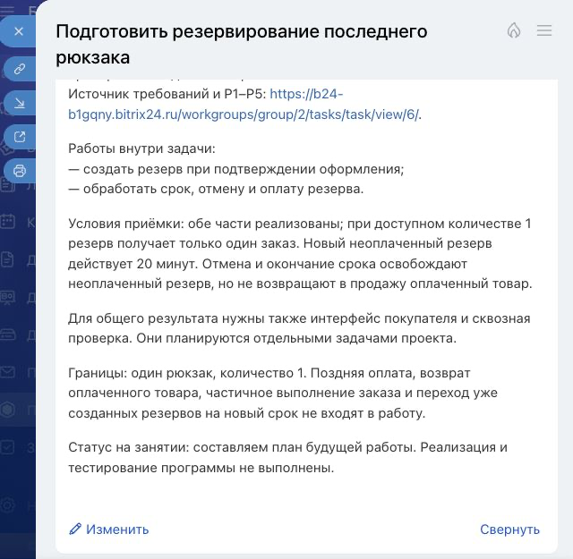
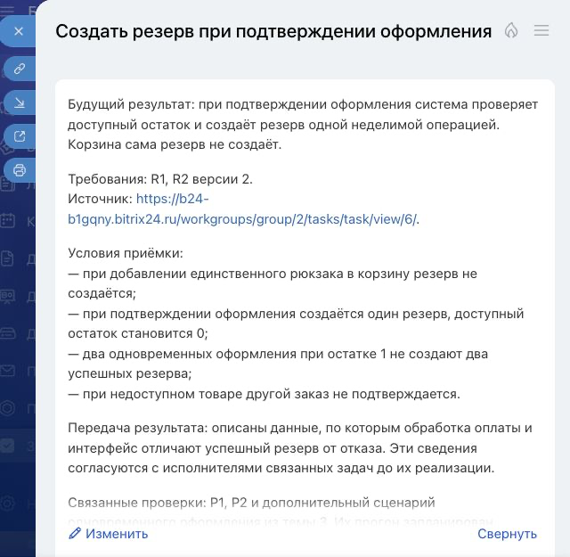
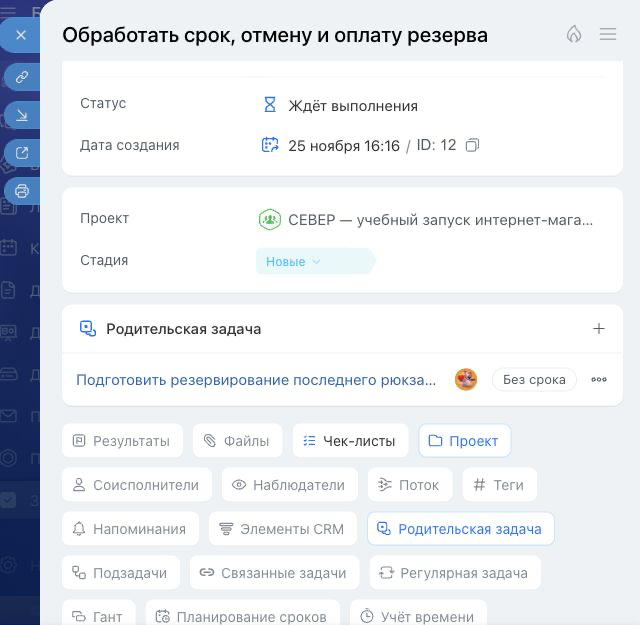
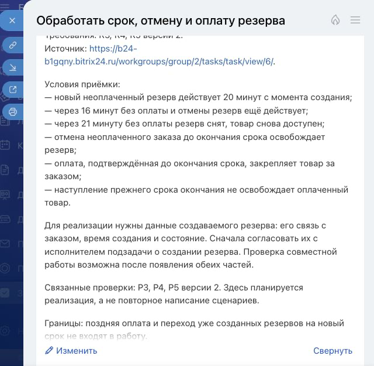
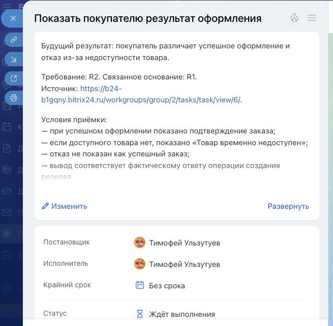
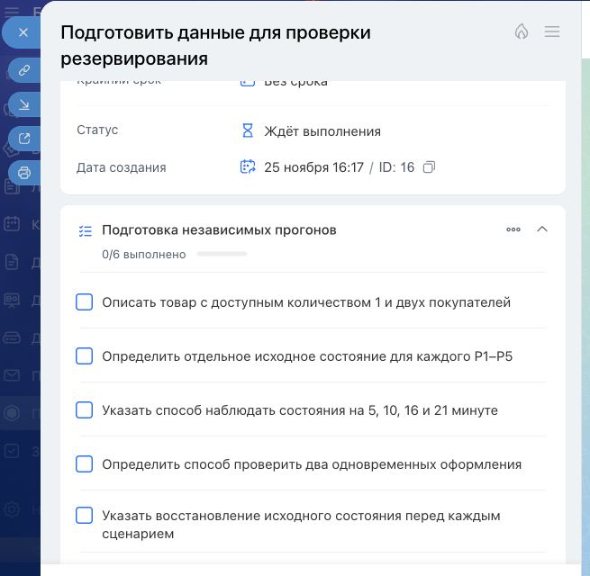
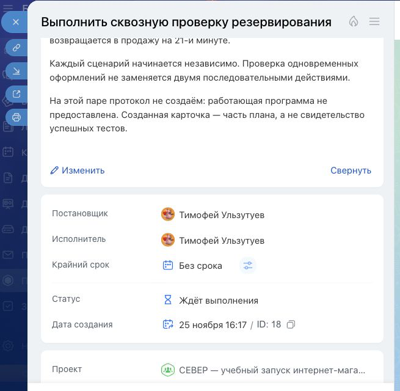
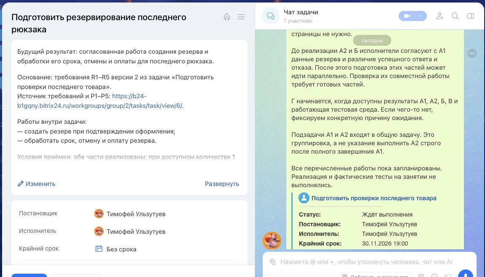
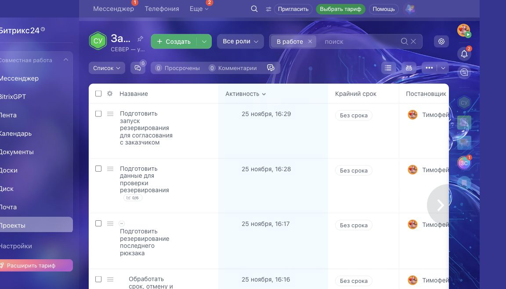

# Отчёт. От требований к плану работ

Репозиторий: https://github.com/TimUlz/project-management

Проект: https://b24-b1gqny.bitrix24.ru/workgroups/group/2/

Источник требований: https://b24-b1gqny.bitrix24.ru/workgroups/group/2/tasks/task/view/6/

Общая задача: https://b24-b1gqny.bitrix24.ru/workgroups/group/2/tasks/task/view/8/

А1: https://b24-b1gqny.bitrix24.ru/company/personal/user/1/tasks/task/view/10/

А2: https://b24-b1gqny.bitrix24.ru/company/personal/user/1/tasks/task/view/12/

Б: https://b24-b1gqny.bitrix24.ru/workgroups/group/2/tasks/task/view/14/

В: https://b24-b1gqny.bitrix24.ru/workgroups/group/2/tasks/task/view/16/

Г: https://b24-b1gqny.bitrix24.ru/workgroups/group/2/tasks/task/view/18/

## Результат

В «СЕВЕРЕ» сохранены шесть карточек плана. А1 и А2 — подзадачи А. Б, В и Г — самостоятельные задачи. Ответственный — Тимофей Ульзутуев. По каждой карточке зафиксирован будущий результат, статус «Ждёт выполнения» и отсутствие срока. В задаче В шесть неотмеченных пунктов. А1 и описание данных В можно начать сразу; А2 и Б согласуют форматы с А1; Г ждёт результатов А1, А2, Б, В и тестовой среды. Порядок и ссылки сохранены в чате А.

## Проверка плана

| Ситуация | Трассировка |
| --- | --- |
| Оплата на 10-й минуте | R5 → А2 закрепляет товар за заказом → P5 в Г проверяет, что на 21-й минуте товар не вернулся в продажу |
| Отмена на 5-й минуте | R4 → А2 снимает неоплаченный резерв → P4 в Г проверяет доступность товара для другого покупателя |
| Второй заказ при активном резерве | R1/R2 → А1 исключает второй резерв → Б показывает отказ → Г сверяет результат по P1/P2 |

Это проверка полноты плана. Реализация и прогоны магазина предстоят.

## Скриншоты

- [Общая задача и подзадачи](screenshots/01-parent-2.png)

  

- [Связи с подзадачами А1 и А2](screenshots/01-parent.png)

  

- [А1 — создание резерва](screenshots/02-create-reservation.png)

  

- [А2 — срок, отмена и оплата](screenshots/03-reservation-state-2.png)

  

- [А2 — критерии обработки резерва](screenshots/03-reservation-state.png)

  

- [Б — интерфейс покупателя](screenshots/04-customer-message.png)

  

- [В — данные и подготовка прогонов](screenshots/05-test-data.png)

  

- [Г — сквозная проверка](screenshots/06-integration-check.png)

  

- [Сохранённый порядок работ в чате А](screenshots/07-work-order.png)

  

- [Задачи проекта и статусы](screenshots/08-project-plan.png)

  
