# Отчёт. CRM и запуск работы

Репозиторий: https://github.com/TimUlz/project-management

Проект: https://b24-b1gqny.bitrix24.ru/workgroups/group/2/

CRM-клиент: https://b24-b1gqny.bitrix24.ru/crm/company/details/2/

CRM-запрос: https://b24-b1gqny.bitrix24.ru/crm/deal/details/2/

Источник требований: https://b24-b1gqny.bitrix24.ru/workgroups/group/2/tasks/task/view/6/

Общая задача: https://b24-b1gqny.bitrix24.ru/workgroups/group/2/tasks/task/view/8/

Задача запуска: https://b24-b1gqny.bitrix24.ru/workgroups/group/2/tasks/task/view/20/

Бриф запуска: https://b24-b1gqny.bitrix24.ru/doc/n6qApqAc0w5SMuGvEvib/edit

## 5.1. Клиент и запрос

Сохранены учебная компания без контактных данных и сделка на стадии «Новая». Запрос — подготовить к согласованию первый запуск резервирования последнего рюкзака. При остатке 1 резерв получает один заказ. Второй покупатель при занятом товаре видит отказ. В карточке CRM сохранены границы и следующий шаг — согласовать состав запуска с учебным заказчиком. Уточнение в ленте фиксирует состав запуска, источник требований, приёмку и исключения. Внутренний комментарий ведёт к задаче запуска.

За рамками поздняя оплата, возврат оплаченного товара, частичный заказ и перенос срока активного резерва.

## 5.2. Запуск работы в проекте

Создана одна незавершённая координационная задача со ссылкой на CRM. План сохранён из практики 04.

- [А — общая задача](https://b24-b1gqny.bitrix24.ru/workgroups/group/2/tasks/task/view/8/)
- [А1 — создание резерва](https://b24-b1gqny.bitrix24.ru/company/personal/user/1/tasks/task/view/10/)
- [А2 — срок, отмена и оплата](https://b24-b1gqny.bitrix24.ru/company/personal/user/1/tasks/task/view/12/)
- [Б — результат для покупателя](https://b24-b1gqny.bitrix24.ru/workgroups/group/2/tasks/task/view/14/)
- [В — подготовка данных](https://b24-b1gqny.bitrix24.ru/workgroups/group/2/tasks/task/view/16/)
- [Г — сквозная проверка](https://b24-b1gqny.bitrix24.ru/workgroups/group/2/tasks/task/view/18/)

Тимофей Ульзутуев координирует связь CRM и проекта, сверяет запрос с требованиями, выполняет план и проверяет результат по P1–P5 в задаче Г. Учебный заказчик согласовывает состав и получает описание и ссылки на результат. В чате задачи сохранено сообщение «Запуск подготовлен к согласованию» и ссылка на бриф.

## 5.3. Проверка разделов

| Раздел | Что подтверждено |
| --- | --- |
| Список задач | Видны координационная задача и карточки плана |
| Канбан | Открывается из задач проекта. Задача запуска в колонке «Новые» |
| Календарь | Открывается. Задача запуска без срока в сетке отсутствует |
| Гант | Открывается из задач проекта и содержит задачу запуска. Даты запуска не назначены |
| Доски | Раздел самостоятельных досок открыт |
| Документы | Бриф сохранён. Связь с CRM и проектом оформлена ссылками в брифе и чате задачи |
| Коммуникация CRM | Внутренний комментарий содержит ссылку на задачу. Итоговое сообщение сохранено в чате проекта |
| Роботы | В существующей воронке открыт робот «Уведомление» для стадии «Новая». В настройках указан запуск «Сразу», получатель — ответственный. При создании сделки сработало штатное внутреннее уведомление. Правило просмотрено без изменений |
| Бизнес-процессы | Открыт каталог. В нём найден шаблон оценки звонков. Подходящего шаблона согласования запуска в списке нет. Ручной путь — зафиксировать состав в CRM, согласовать бриф в задаче и записать итог в CRM |
| BI Конструктор | Каталог открыт. «Аналитика дел по сделкам» помечена как недоступная. Вопрос отчёта — на каком этапе запрос, кто отвечает за следующее действие и какой результат ждёт заказчик |

Готовы материалы для согласования. Фактическая реализация и проверка магазина предстоят. Ссылки на карточки и брифы открываются в учебном портале с соответствующим доступом.

## Скриншоты

- [CRM-клиент](screenshots/01-crm-client.png)

  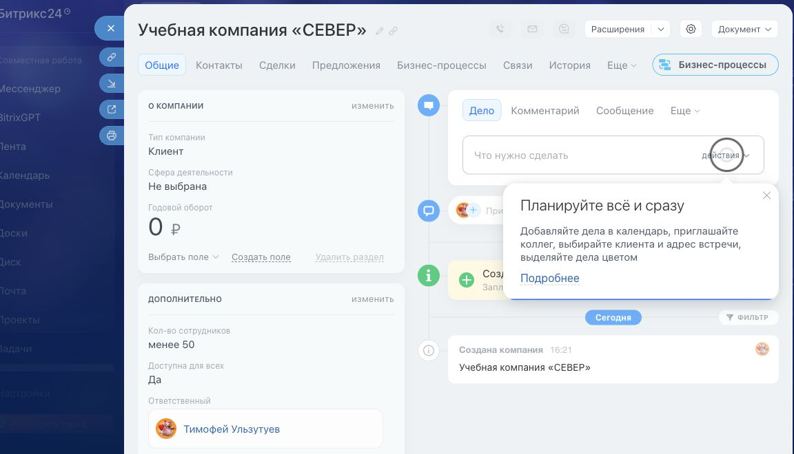

- [CRM-запрос](screenshots/02-crm-request.png)

  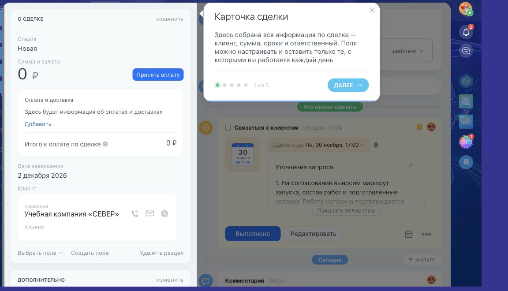

- [Уточнение запроса](screenshots/03-request-clarification.png)

  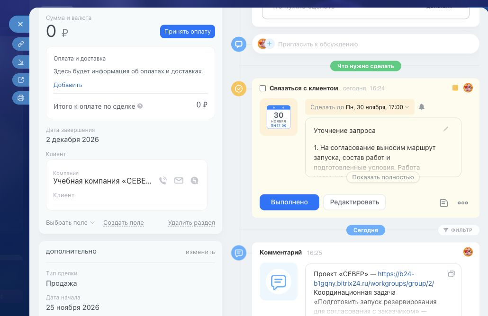

- [Координационная задача запуска](screenshots/04-launch-task.png)

  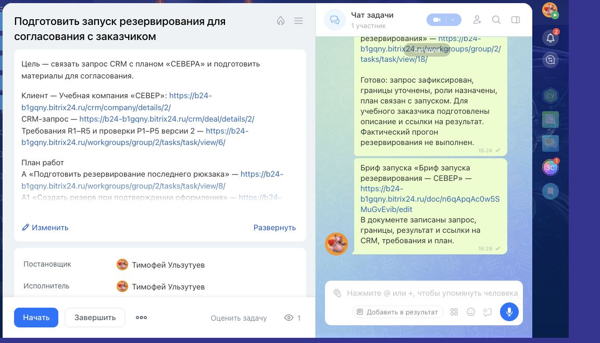

- [Роли и итоговое сообщение](screenshots/05-launch-roles-message.png)

  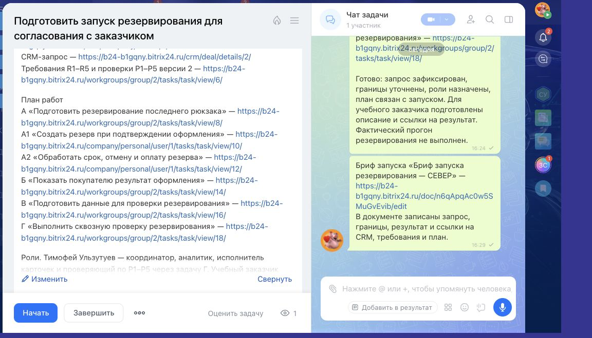

- [Список или канбан проекта](screenshots/06-project-kanban.png)

  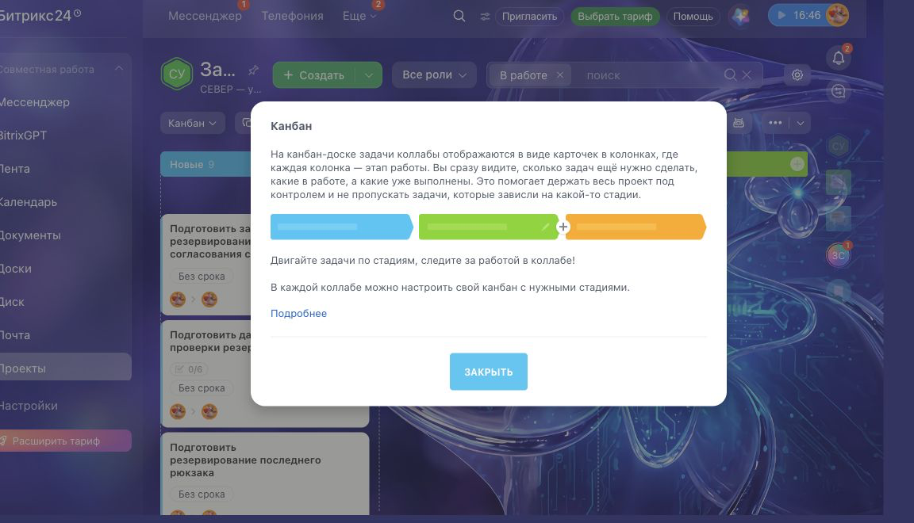

- [Календарь и Гант](screenshots/07-calendar-gantt.png)

  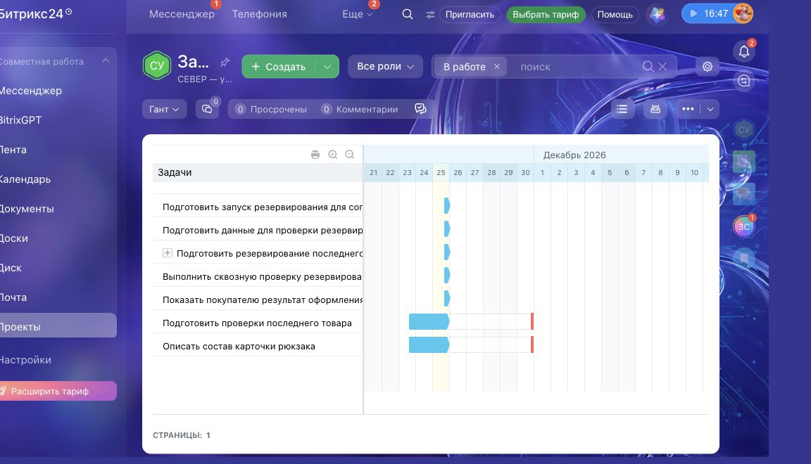

- [Бриф запуска](screenshots/08-launch-brief.png)

  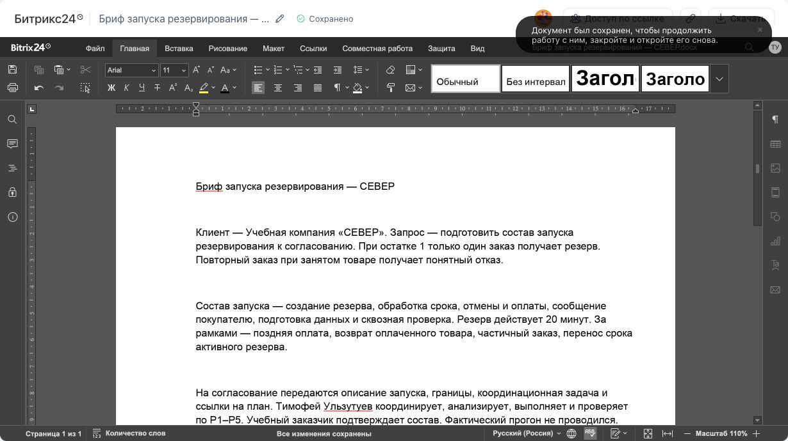

- [Канал CRM-коммуникации](screenshots/09-crm-channel.png)

  

- [Автоматизация, процесс и BI](screenshots/10-automation-process-bi.png)

  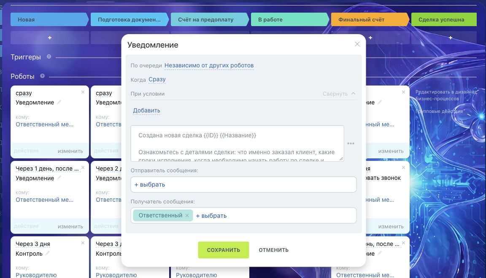

- [Список задач проекта](screenshots/04-project-list.jpg)

  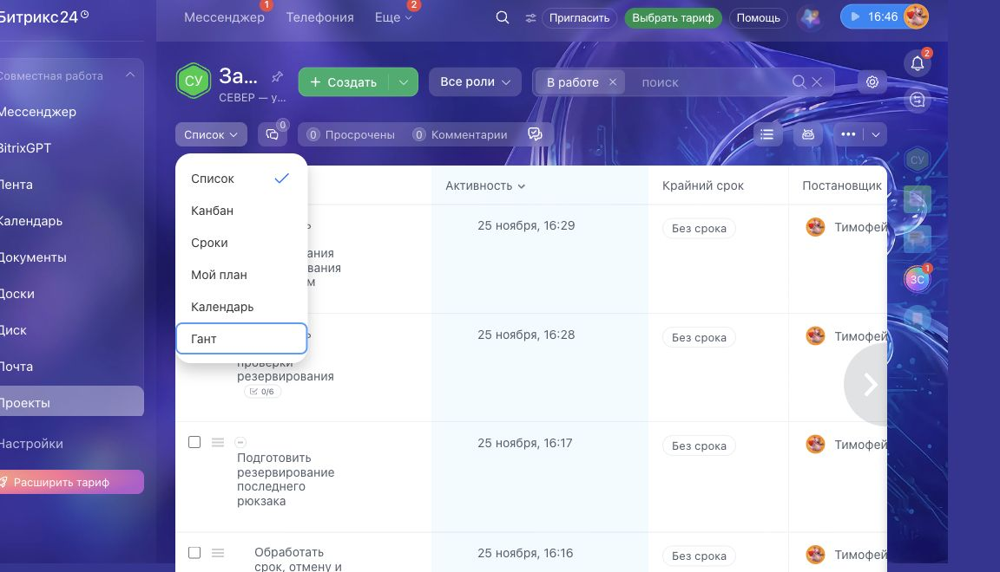

- [Календарь задач проекта](screenshots/06-calendar.jpg)

  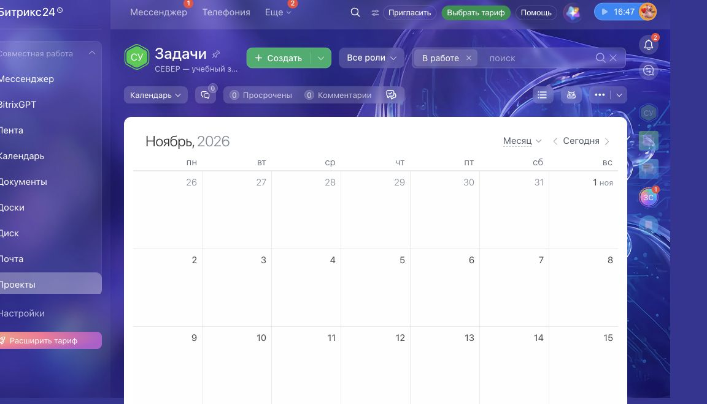

- [Самостоятельный раздел «Доски»](screenshots/09-boards.jpg)

  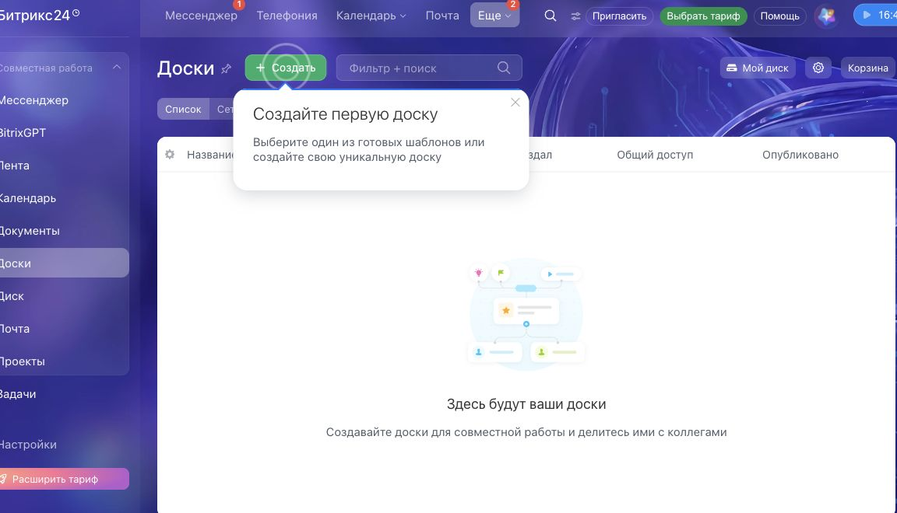

- [Каталог шаблонов бизнес-процессов](screenshots/11-processes.jpg)

  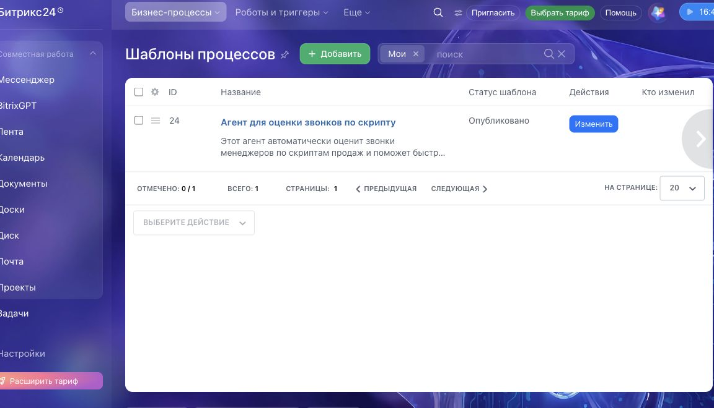

- [Список отчётов BI по CRM](screenshots/12-bi.jpg)

  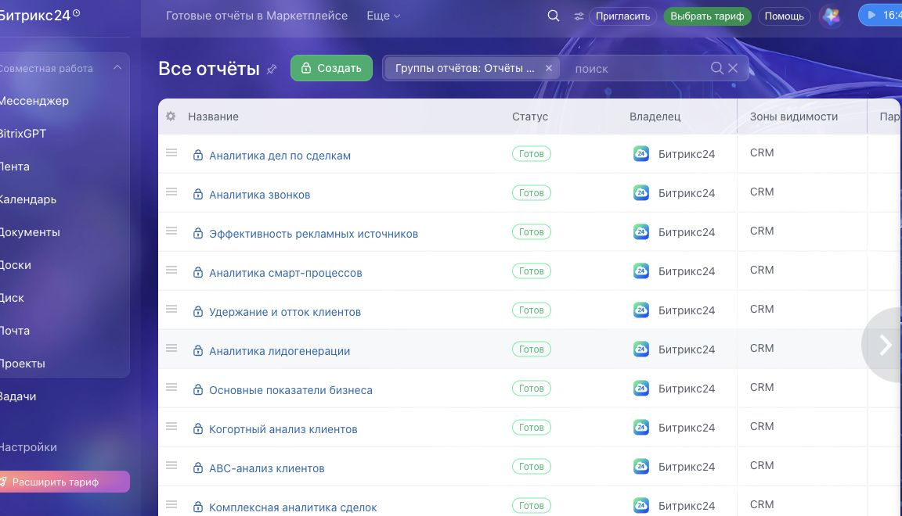

- [Брифы в разделе «Документы»](screenshots/13-documents.jpg)

  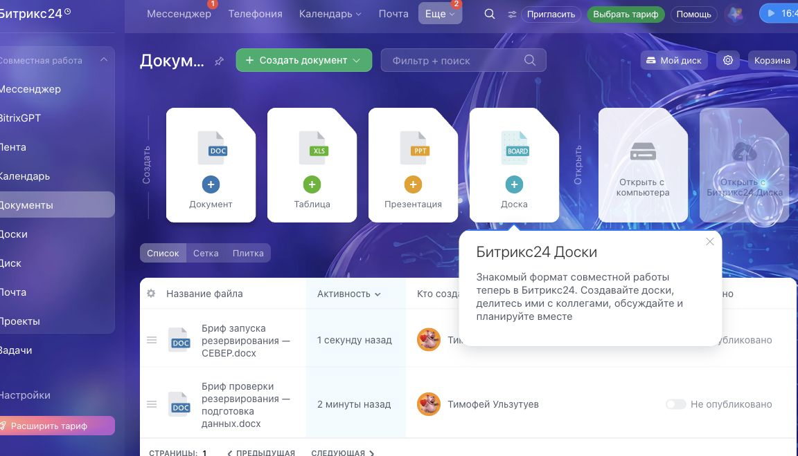
