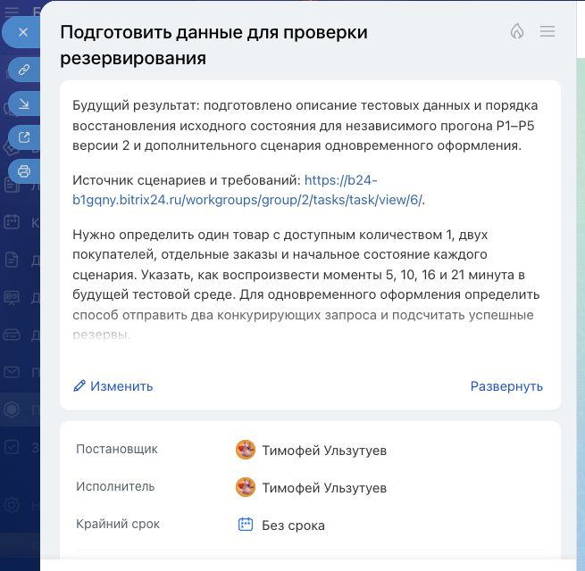
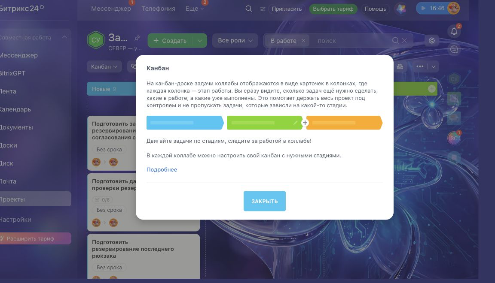
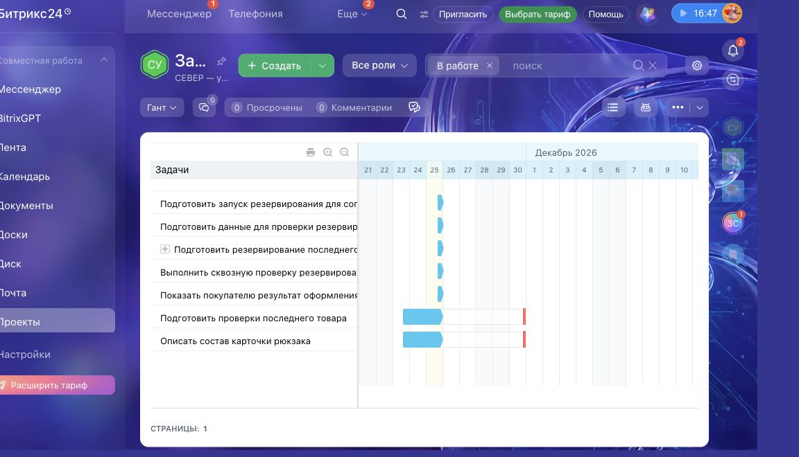
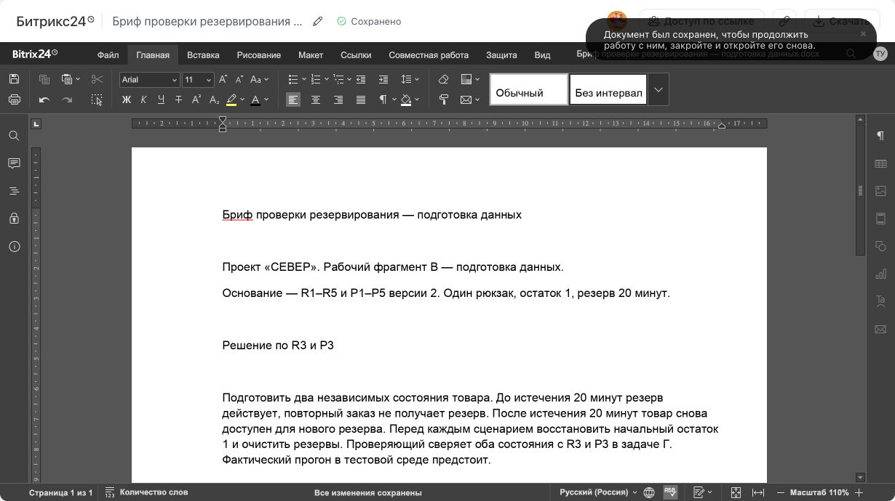
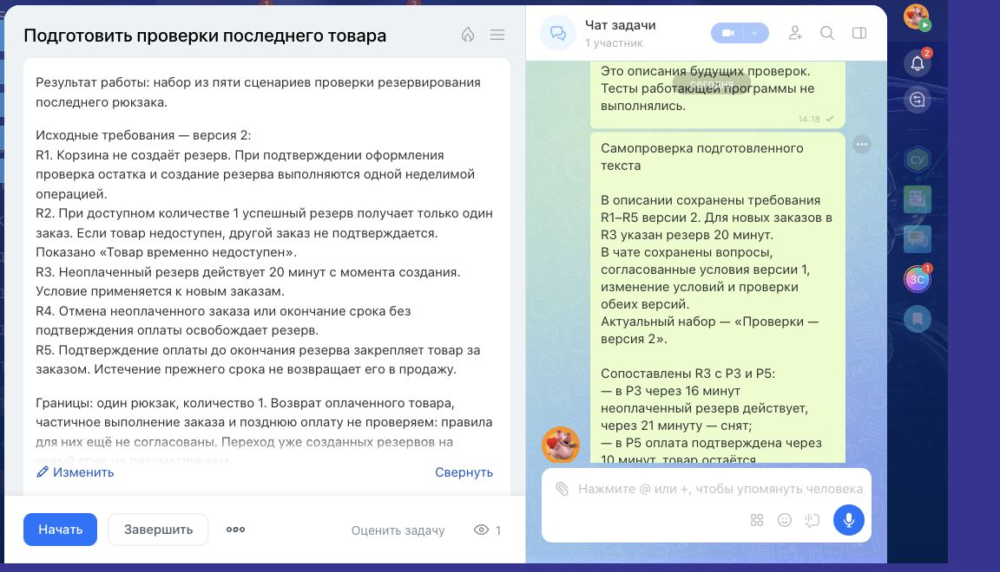

# Отчёт. Рабочее пространство выполнения проекта

Репозиторий: https://github.com/TimUlz/project-management

Проект: https://b24-b1gqny.bitrix24.ru/workgroups/group/2/

Источник требований: https://b24-b1gqny.bitrix24.ru/workgroups/group/2/tasks/task/view/6/

Задача В: https://b24-b1gqny.bitrix24.ru/workgroups/group/2/tasks/task/view/16/

Задача Г: https://b24-b1gqny.bitrix24.ru/workgroups/group/2/tasks/task/view/18/

Бриф: https://b24-b1gqny.bitrix24.ru/doc/ydxpbhr5egWhRJfkdj1X/edit

Канбан: https://github.com/TimUlz/project-management/blob/main/lesson_06/screenshots/03-kanban-v.png

Календарь: https://github.com/TimUlz/project-management/blob/main/lesson_06/screenshots/04-calendar.png

Гант или план: https://github.com/TimUlz/project-management/blob/main/lesson_06/screenshots/05-gantt-plan.png

Обсуждение задачи В: https://b24-b1gqny.bitrix24.ru/workgroups/group/2/tasks/task/view/16/

## 6.1. Задача и канбан

Для работы использована существующая карточка В из практики 04. Статус «Ждёт выполнения», этап канбана «Новые», чек-лист 0 из 6. Тимофей Ульзутуев координирует работу, сверяет R1–R5, готовит независимые данные и проверяет их по P1–P5. Учебная компания «СЕВЕР» принимает описание результата как заказчик.

## 6.2. Время и рабочие материалы

Календарь проекта открылся, В без срока не отображается. В Ганте виден список плана с В и Г, сроки по ним не заданы. Порядок работ сохранён в чате А. В «Документах» создан рабочий бриф с исходными данными, ролями, границами и адресами В, Г и источника требований. Ссылка на документ сохранена в обсуждении В.

## 6.3. Решение и трассировка

В чате В сохранён вопрос о подготовке обоих состояний товара. Решение перенесено в бриф. Для P3 готовятся два независимых состояния при исходном остатке 1.

1. До истечения 20 минут резерв действует и повторный заказ не получает резерв.
2. После истечения 20 минут товар снова доступен для нового резерва.

Перед каждым сценарием восстанавливается остаток 1 и очищаются резервы. Проверяющий сверяет оба состояния с R3 и P3 в задаче Г.

**Трассировка** — R3 задаёт срок 20 минут → P3 описывает оба состояния → В готовит входы → бриф фиксирует решение → Г использует входы для сквозной проверки.

Рабочее пространство и материалы для проверки подготовлены. Фактический прогон в тестовой среде предстоит. Записи Битрикс24 доступны участникам учебного портала.

## Скриншоты

- [Существующая задача В](screenshots/01-task-v.png)

  

- [Роли работы](screenshots/02-roles.png)

  

- [Канбан с задачей В](screenshots/03-kanban-v.png)

  

- [Проверка календаря](screenshots/04-calendar.png)

  

- [Гант или план](screenshots/05-gantt-plan.png)

  

- [Рабочий бриф](screenshots/06-brief.png)

  

- [Связь брифа с задачами](screenshots/07-brief-link-task-v.png)

  

- [Вопрос и решение](screenshots/08-question-decision.png)

  

- [Трассировка](screenshots/09-traceability.png)

  
